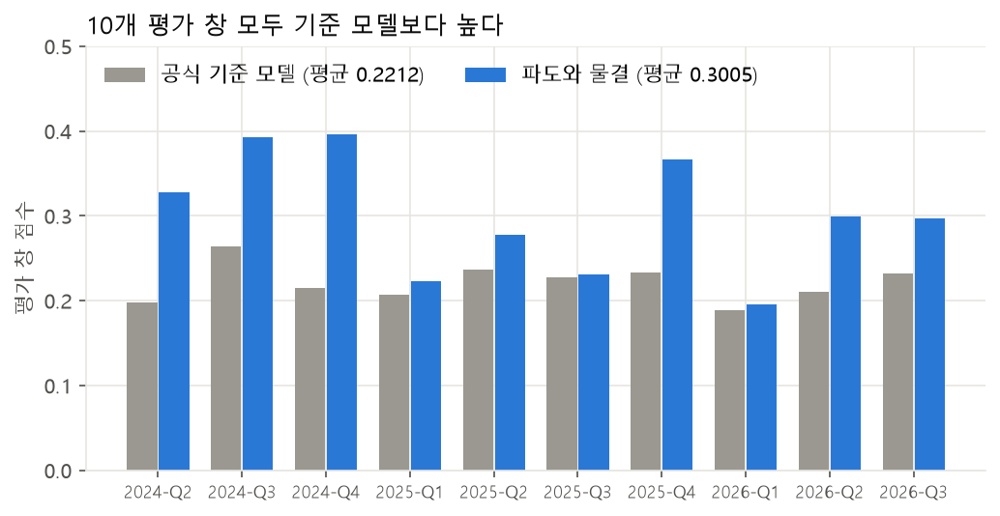
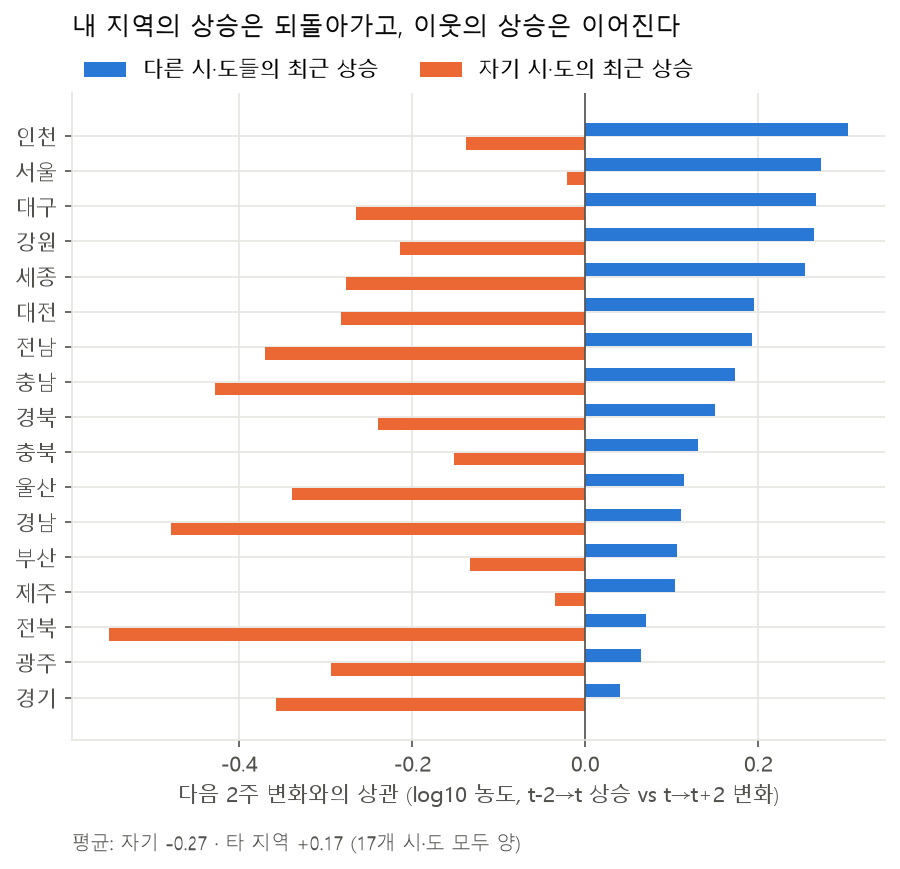
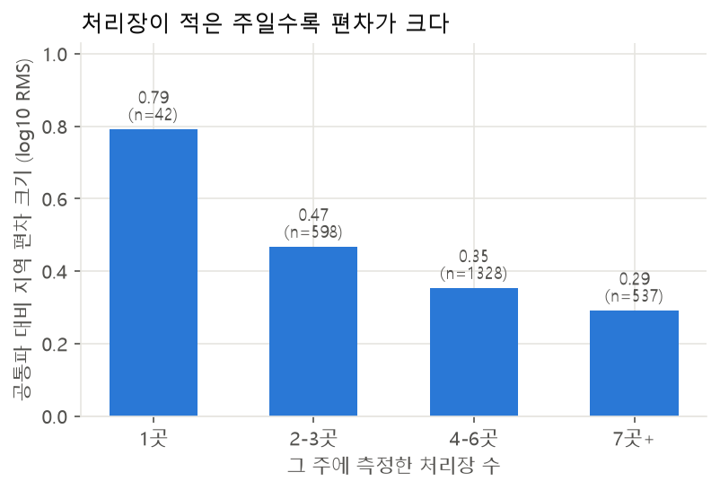
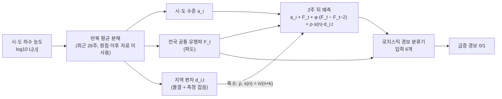
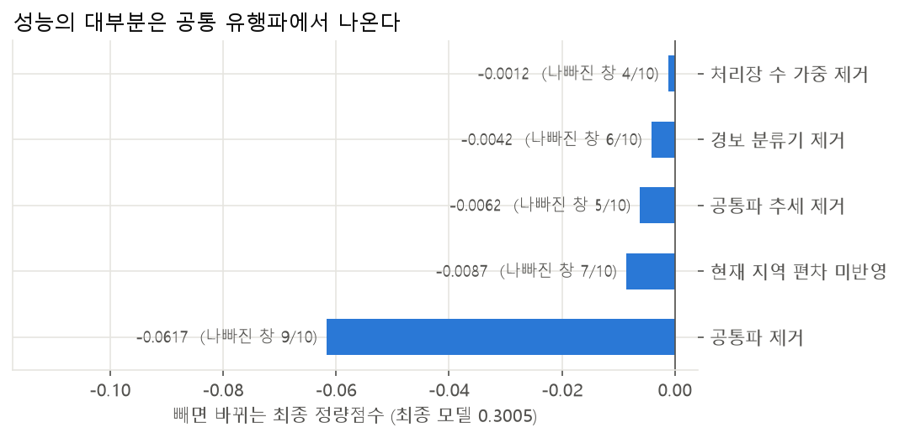
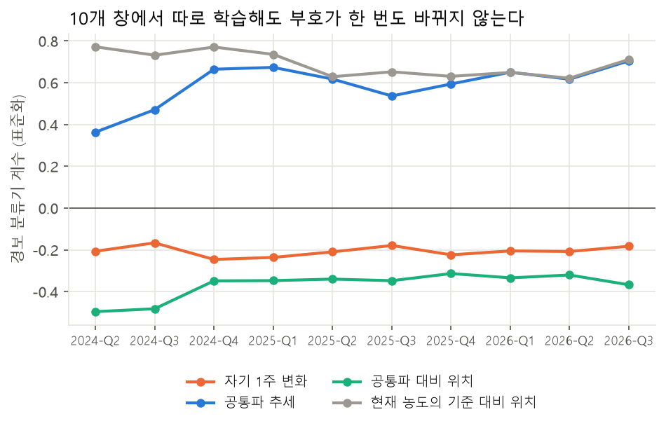
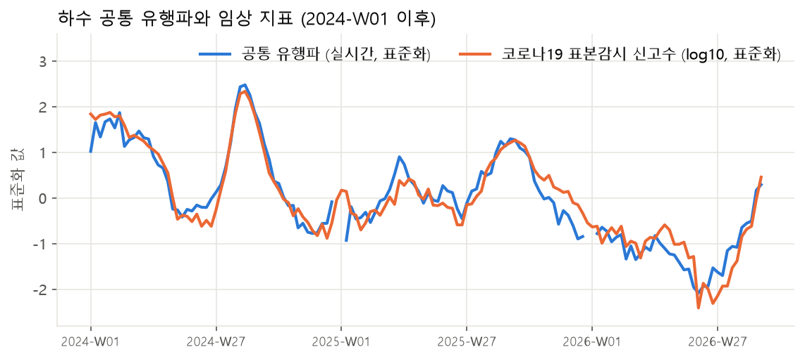
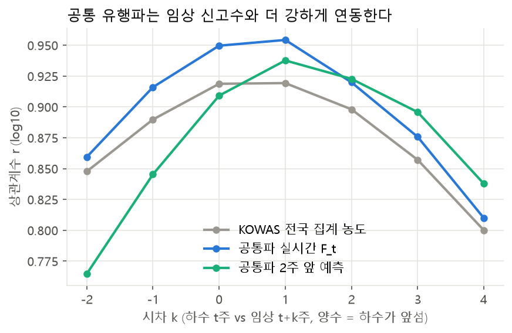
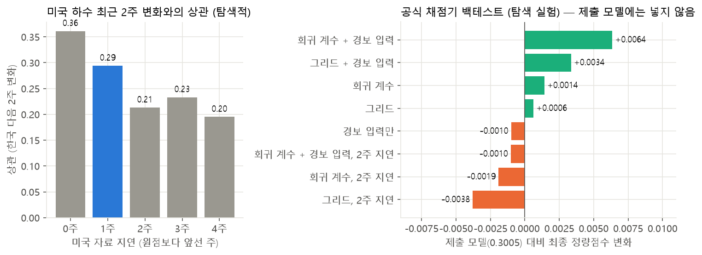
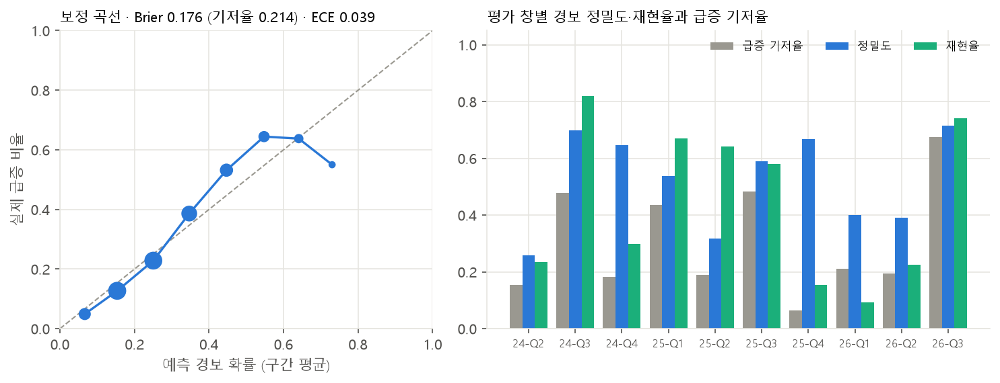

# 파도는 함께, 물결은 따로 — 하수 감시 데이터 기반 감염병 유행 조기예측

> **2026 DATA·AI 분석 경진대회 (KISTI) · 하수 감시 데이터 기반 감염병 유행 조기예측 AI 모델 개발 (PROB_4611) · 개인 참가 (j2tori · 전건우) · 2026.11**
>
> 시·도 하수 바이러스 농도를 **전국 공통 유행파(파도) + 지역 편차(물결) + 측정 잡음**으로 나눠,
> **2주 뒤 농도와 급증 경보**를 예측합니다.

<p align="center"></p>

## 한눈에 보기

| | 공식 기준 모델 | **이 모델** |
|---|---|---|
| 최종 정량점수 (평가 창 10개 평균) | 0.2212 | **0.3005** (+0.079, 95% 구간 +0.052 ~ +0.099) |
| 기준 모델보다 높은 평가 창 | – | **10 / 10** |
| 평가 창 평균 sMAPE | 66.1% | **59.0%** |
| 평가 창 평균 Macro-F1 | 0.5530 | **0.6025** |
| 경보 정밀도 / 재현율 | 0.485 / 0.386 | **0.562 / 0.564** |

- 공식 채점기(`evaluation.py backtest`)로 평가 창마다 새 프로세스에서 다시 학습한 결과이며, 같은 명령을 다시 실행하면 예측이 바이트 단위로 같습니다.
- 성능의 대부분은 **공통 유행파**에서 나옵니다. 이 성분 하나를 빼면 점수가 −0.062 떨어집니다 (10개 창 중 9개 악화).

---

## 1. 데이터를 보고 세운 가설

<p align="center"></p>

| 발견 (배포 패널 3,043행) | 수치 | 모델에 반영한 방식 |
|---|---|---|
| 내 시·도의 최근 2주 상승은 다음 2주 변화와 **반대로** 움직인다 | 평균 상관 −0.27 | 지역 편차를 줄여 일부(rho)만 다음으로 넘긴다 |
| 다른 시·도들의 최근 상승은 **같은 방향**으로 이어진다 | 17개 시·도 모두 양, 평균 +0.17 | 예측의 중심을 전국 공통 유행파에 둔다 |
| 측정 처리장이 적을수록 공통파 대비 편차가 크다 | 1곳 0.79 → 7곳 이상 0.29 (log10) | 처리장이 적은 시·도의 편차를 더 줄인다 |
| 추정한 공통 유행파는 임상 신고수와 더 강하게 연동된다 | 수준 r 0.954 (KOWAS 전국 집계 0.919) | 조기경보 화면의 전국 위상 참고 지표 |

<p align="center"></p>

## 2. 모델



```
log10 농도 L[i,t] = a_i (시·도 수준) + F_t (공통 유행파) + d_{i,t} (지역 편차) + e_{i,t} (측정 잡음)

t+2주 예측  = a_i + F_t + phi·(F_t − F_{t−2}) + rho·s(n)·d_{i,t},   s(n) = n/(n+k)
급증 경보   = 로지스틱 분류기 확률 ≥ 임계값
```

- `w, phi, rho, k`는 각 평가 창의 학습 구간 안에서 롤링 검증으로 고릅니다. 학습된 가중치나 특정 주차를 가리키는 조건문은 코드에 없습니다.
- 참가신청서의 칼만 필터 설계를 **모수 4개의 반복 평균 분해**로 단순화했습니다. 독립 시계열이 17개(179주)뿐이라 상태공간 모수를 창마다 안정적으로 추정하기 어려웠기 때문입니다.

## 3. 무엇이 성능을 만들었나 — 성분별 제거 실험

<p align="center"></p>

| 뺀 성분 | 최종 정량점수 | 변화 | 나빠진 창 |
|---|---|---|---|
| (최종 모델) | 0.3005 | – | – |
| **공통 유행파** | 0.2388 | **−0.0617** | **9 / 10** |
| 현재 지역 편차 미반영 (rho = 0) | 0.2919 | −0.0087 | 7 / 10 |
| 공통파 추세 (phi = 0) | 0.2943 | −0.0062 | 5 / 10 |
| 경보 분류기 (비율 규칙으로 대체) | 0.2963 | −0.0042 | 6 / 10 |
| 처리장 수 가중 (k = 0) | 0.2993 | −0.0012 | 4 / 10 |

평가 창마다 따로 학습한 경보 분류기의 계수 부호도 **10개 창 모두 가설과 같은 방향**이었습니다 (내 지역이 방금 올랐으면 경보 확률↓, 전국 유행이 오르면↑).

<p align="center"></p>

## 4. 임상 지표와의 관계

<p align="center"></p>

<p align="center"></p>

임상 유행의 전환점(상승 시작·정점 12개) 기준으로 하수는 대체로 1~2주 앞섰습니다(선행 주수 중앙값: 공통파 2주). 다만 이 전환점은 앞뒤 6주 자료로 정한 사후 정의라, 모델의 2주 앞 예측이 임상을 2주 앞선다는 근거로 쓰지 않았습니다.

## 5. 시도했지만 넣지 않은 것

| 실험 | 결과 | 판단 |
|---|---|---|
| **ASOS 기상 결합** (처리장 최근접 관측소 강수·기온) | 0.2910 ~ 0.2957, 희석 신호 r = −0.003 | 시·도 집계에서는 효과 없음 → 제출 모델에서 끔 |
| **해외 파도** (미국 CDC 하수 감시 약 47만 표본으로 주간 지수) | 1주 지연 가정 0.3069 (+0.0064), 2주 지연 0.2995 (−0.0010) | 발표 지연에 민감하고 사후 보정 자료라 제외. 보조 지표 후보로 제시 |
| 유역 단위 매핑 (DataON 하천망) | 일정 안에 매핑표를 만들지 못함 | 다음 검증 후보 |

<p align="center"></p>

## 6. 한계

- 7개 창은 기준 모델보다 0.04 이상 앞서지만, 3개 창(2025-Q1·2025-Q3·2026-Q1)은 근소한 차이입니다.
- 급증이 드문 창에서는 경보 재현율이 낮고(0.15·0.09), 같은 주 안 시·도 순위의 변별력(AUC 0.63)도 약합니다.
- 권장 목표(0.38)에는 미달했습니다. 미래 공통파를 안다고 가정한 오라클도 sMAPE 개선이 평균 20.7%에 그쳐, 남은 오차의 상당 부분은 지역 편차에 있습니다.
- 변형 선택에도 같은 10개 평가 창을 썼으므로, 독립된 미래 기간 검증은 하지 않았습니다.

<p align="center"></p>

---

## 저장소 구성

| 경로 | 내용 |
|---|---|
| [`4611_KOWAS/`](4611_KOWAS/) | 제출 결과물 전체. 실행 환경·실행 방법·평가 창별 결과·출처는 [4611_KOWAS/README.md](4611_KOWAS/README.md) |
| `4611_KOWAS/submit/` | 최종 평가용 코드 패키지 (`model.py`, `requirements.txt`, `RUN.md`, `predictions.csv`, `score.json`) |
| `4611_KOWAS/src/`, `scripts/` | 신호 분석, 제거 실험, 기상·외부자료 실험, 임상 선행성, 그림 생성 |
| `4611_KOWAS/notebooks/analysis.ipynb` | 데이터 확인 → 신호 분석 → 모델 학습 → 공식 백테스트 → 분석 (패널 원값은 출력하지 않음) |
| `4611_KOWAS/runs/` | 실험 결과(JSON·예측 CSV)와 실험기록 |
| `4611_KOWAS/figures/` | 그림 9종 |
| `4611_KOWAS/docs/` | 생성형 AI 활용 범위, 프로젝트 한눈에 보기(HTML) |
| `4611_문서자료/` | 문제해결 설명서(PDF) |

> **대회 배포 데이터는 포함하지 않았습니다.** 문제 규정 §9-1에 따라 KOWAS 패널·전국 집계 원값(`data/`)을 제외했고, 원값과 같거나 원값을 역산할 수 있는 파일(공식 기준 모델 예측 `runs/baseline_pred.csv`, 처리장 목록 `external/plant_catchment.csv`, 최신 주 기준선 비율이 담긴 `figures/조기경보_프로토타입.html`)도 공개 저장소에서 뺐습니다. 남은 파일은 모델 예측값·상관계수·점수 같은 파생 결과입니다.

## 빠른 실행

```bash
# 배포 데이터 KOWAS-EPI_전체데이터_v2.5.zip 을 4611_KOWAS/data/ 에 풉니다
cd 4611_KOWAS
python -m venv .venv
.venv/Scripts/python -m pip install -r requirements-dev-lock.txt
cd data/KOWAS-EPI
../../.venv/Scripts/python evaluation.py backtest --model ../../submit/model.py --out ../../submit/predictions.csv --json ../../submit/score.json
# 기대 출력: 최종 정량점수 (평가 창 10개 평균) = 0.3005
```

---

**기술:** Python · NumPy(제출 모델은 NumPy만 사용) · 시계열 분해 · 축소 추정 · 로지스틱 회귀 · 롤링 백테스트 · 블록 부트스트랩 · pandas · matplotlib

---

👤 [전건우 GitHub 프로필](https://github.com/j2tori-design) · 📂 [전체 프로젝트 목차](https://github.com/j2tori-design/contest-portfolio)
